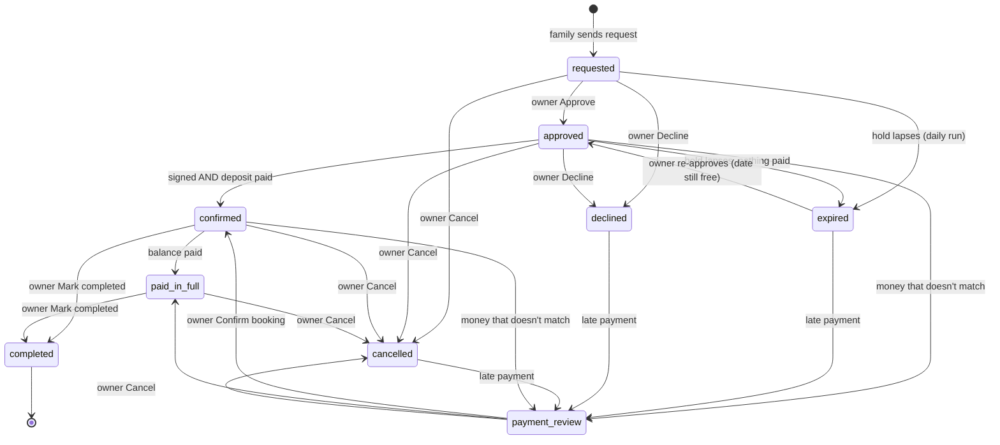

# The client journey — after a family books

What happens from the moment a family sends a request to the day they get their photos, video and album. Everything here is built and covered by tests (`src/lib/journey/*.test.ts`), unless it is marked *spec only*.

**The two rules everything is built on:**

1. **Money only moves when the owner clicks.** The site never charges a family on its own: a family starts a payment by tapping "Pay". The site never refunds on its own either: only the owner's **Refund** button does. Holds expire, reminders go out and Stripe sessions close automatically. None of those move money.
2. **A family sees only its own booking.** Each family reaches its page by a private link (`/my/booking/{token}` or `/es/mi-reserva/{token}`). Only a SHA-256 of the token is stored. Without the link, the page is a 404.

Code map: `src/lib/journey/` (rules + operations), `src/lib/emails/` (one module per email), `src/components/journey/` (family page), `src/app/admin/bookings/` (admin), `supabase/migrations/0023_client_journey.sql` (schema).

---

## 1. Journey map

| # | Step | Who acts | What changes | Emails |
|---|------|----------|--------------|--------|
| 1 | **Request.** The family picks a package, hours, extras and a date on the homepage and sends it. No signature yet. | Family | Booking `requested`. The date is held for the price book's `holdDays` (default 7). Money is snapshotted. A private link is created. | family: *request-received* · owner: *owner-new-request* |
| 2a | **Approve** | Owner (Approve) | `requested`/`expired` → `approved`. The hold now runs `APPROVAL_HOLD_DAYS` (7) from approval. | family: *approved* |
| 2b | **Decline** | Owner (Decline) | → `declined`. Any open Stripe Checkout is expired at Stripe. The date is freed. | family: *declined* |
| 3a | **Sign.** The family reads the agreement, ticks the e-sign consent, types their name and draws a signature. | Family | `signed_at` and the signed agreement are stored. They are immutable after this (DB trigger). A PDF is saved to R2. Audit: time, IP, user agent, consent version, agreement + template version, SHA-256. | family: *contract-signed* (PDF) · owner: *owner-contract-signed* (PDF) |
| 3b | **Pay the deposit.** "Pay deposit $X" opens Stripe Checkout. | Family | The webhook records the payment. `approved` → `confirmed` only when **signed AND deposit paid**. | family: *payment-received* · owner: *owner-payment* |
| 4 | **Balance.** Due `balance_due_days` (snapshot, default 14) before the event. | Family pays ("Pay balance $X"), or owner records Zelle/cash | → `paid_in_full` when nothing is left. | reminders at 30/14/7/1 days before the due date, plus one overdue notice · owner "Send balance link" → *balance-link* |
| 5 | **Change / cancel requests.** The family writes from their page. | Family → owner | Nothing changes on its own. It's a message. The owner acts in admin. | owner: *owner-message* · owner reply → family: *owner-reply* |
| 6 | **Refunds** | Owner only (Refund…) | Stripe Refunds API, idempotency key, capped at what is refundable on that charge. A ledger row is added. | family: *refund-issued* |
| 7 | **After the event.** The family's page becomes the delivery page: gallery link, video link, album status, Google review link. | Owner edits delivery fields, marks completed | `confirmed`/`paid_in_full` → `completed` | family: *delivery-update* (only when the owner clicks "Save & email family") |

The daily run (`/api/cron/daily`) expires lapsed holds and their Stripe sessions, sends the balance reminders, sends the owner one digest, and sends the family one "sign and pay" nudge.

## 2. State diagram

The single source is `TRANSITIONS` in `src/lib/journey/state.ts` (`canTransition(from, to)`). Every status write splices `status in sourcesOf(to)` into the `UPDATE … WHERE`, so a stale check or a forged POST can't land.

`refunded` exists only for legacy rows. A refund is a ledger entry, not a status. The date is held by `requested`, `approved`, `confirmed`, `paid_in_full` and `completed` (partial unique index).

Legacy statuses were migrated in place by 0023: `pending_payment` → `approved`, `paid` → `confirmed`. Homepage agreements signed before this change had their signature lifted onto `signed_at` / `agreement`.

## 3. Every email and its trigger

All emails live in `src/lib/emails/`, one module per email. Each is written in the family's language (`bookings.lang`), uses the same look as the old `agreement-email.ts`, and escapes with `src/lib/html-escape.ts`. Every family email carries a freshly minted private link. Only hashes are stored, so a link can't be re-sent; a new one is minted for each email instead.

| Module | To | Trigger |
|---|---|---|
| `request-received` | family | request saved (`/api/commission`) |
| `owner-new-request` | owner | every request (audit M1) |
| `approved` | family | owner clicks **Approve** |
| `declined` | family | owner clicks **Decline** (optional note) |
| `cancelled` | family | owner clicks **Cancel booking** (optional note) |
| `contract-signed` | family, PDF attached | family signs |
| `owner-contract-signed` | owner, PDF attached | family signs |
| `payment-received` | family | Stripe payment recorded (webhook), or owner records Zelle/cash |
| `owner-payment` | owner | a Stripe payment is recorded, or **payment needs review** (late, wrong amount, wrong booking) |
| `balance-link` | family | owner clicks **Send balance link** |
| `balance-reminder` | family | daily run: 30, 14, 7 and 1 days before the balance due date, plus one overdue notice. Each sent once (`booking_reminders` unique `(booking, kind)`). |
| `refund-issued` | family | owner's refund succeeded |
| `owner-message` | owner | family sends a question / change / cancel request |
| `owner-reply` | family | owner replies in admin |
| `magic-link` | family (stored address only) | "Email me my link" (`/my/booking`, `/es/mi-reserva`) |
| `owner-nudge` | owner | daily run, once per booking: requests unapproved > 24h, approved-unpaid > 48h, holds that lapsed |
| `unsigned-nudge` | family | daily run, once: approved > 48h and not signed |
| `hold-expired` | family | daily run: an **approved** hold lapsed with nothing paid |
| `delivery-update` | family | owner clicks **Save & email family** on delivery fields |

**Mail sink:** when `MAIL_SINK=1`, when `RESEND_API_KEY` is unset, or whenever `NODE_ENV` isn't `production`, nothing is sent. Each email is written to `.mail-sink/<time>-<tag>.html` + `.json` (gitignored) instead.

## 4. What the owner clicks (admin)

`/admin/bookings` lists bookings. Filters: All · New requests · Upcoming · Balance due (30 days) · Unread messages · Needs review · Closed, plus `?status=`. The **Bookings** nav item shows a badge for new requests + unread messages + payments to review.

`/admin/bookings/{id}` is the booking record:

- **Actions:** Approve · Decline · Send balance link · Confirm booking (only for *payment needs review*) · Mark completed · Cancel booking · Copy family link. Every action that emails or moves money asks first.
- **Messages:** the inbox. Opening the record marks the messages read. Replies are emailed.
- **Payments:** totals, the ledger (charges + refunds with Stripe ids), and **Refund…** per Stripe charge. You type an amount; it is capped server-side at what is left on that charge, and an idempotency key stops a double click from refunding twice. **Record a payment made outside Stripe** handles Zelle / cash / check and can't exceed what is left. Checkout sessions are listed too.
- **Delivery:** gallery link, video link, Google review link (`https://` only), album status, a note to the family, and Save / Save & email family.
- **Timeline:** every event with actor, IP and detail, plus which reminders went out.
- **Details**, **Price snapshot (frozen at request)**, **Documents** (signed PDF, signer, IP, versions, SHA-256), **Private notes** (never shown to the family).

`/admin/bookings/contract` is the **contract template**: versioned, append-only overrides (the cancellation policy lines and one extra section, per language). Approved families who haven't signed see the newest version. Signed bookings keep the exact text they signed.

## 5. Cancellation policy — ⚠ needs the owner's review

One exported constant, `CANCELLATION_POLICY` in `src/lib/journey/policy.ts`. It is shown on every family page and copied into the agreement. The owner can override it per version at `/admin/bookings/contract`. **First draft:**

> - Your deposit is not refundable. It holds your date, and we turn other families away for it.
> - You can move your date once, at no cost, if we're free on the new date. Ask at least 60 days before your event.
> - Want more hours or an extra? Ask any time — if we're free, we add it and update your total.
> - If you cancel, we keep the deposit and refund anything you paid beyond it.
> - If we ever have to cancel, we refund everything you've paid.
> - Nothing changes until we write back to confirm it.

The Spanish version is in the same constant. Questions for the owner: is "move once / 60 days" right? Should a late cancellation (say, under 30 days) owe more than the deposit? The e-sign consent text (`ESIGN_CONSENT` in `src/lib/contract-pdf.ts`) is also marked as needing review.

## 6. Installments — *spec only, not built*

Some families want to split the balance.

- **Data:** add `booking_installments(booking_id, n, due_date, amount_cents, paid_payment_id, unique(booking_id, n))`. The plan is fixed when the owner offers it and must sum to the balance snapshot. Allowed plans: 2–4 equal monthly parts, the last due by `balance_due_date`.
- **Owner action:** "Offer a payment plan" on the record. The owner picks the number of parts, sees the dates and amounts, and confirms. The family is emailed and the plan shows on their page. It's never automatic: no saved cards, no off-session charges. Each part is a family-started Checkout for that part's amount (`kind = "installment"`, metadata `installment_n`).
- **Ledger:** each paid part is a `booking_payments` row. `settle()` stays the same: `paid_in_full` when `remainingCents = 0`.
- **Reminders:** kinds `installment_{n}_7`, `installment_{n}_1` and `installment_{n}_overdue`, idempotent through `booking_reminders` like today.
- **Refund cap and admin record:** unchanged (per charge).
- **Not doing:** Stripe subscriptions or saved payment methods, because money must only move when someone clicks.

## 7. Scheduling (no pg_cron — audit M2)

`GET /api/cron/daily` needs `Authorization: Bearer $CRON_SECRET`, compared in constant time; without `CRON_SECRET` it answers 401. It is idempotent: transitions are guarded and every email is claimed before sending.

It is wired as a **Cloudflare Cron Trigger**. `wrangler.jsonc` points `main` at `cloudflare/worker.ts`, which re-exports OpenNext's generated `fetch` handler and adds `scheduled`. That handler calls `/api/cron/daily` *in-process* with the secret. `triggers.crons = ["5 13 * * *"]` runs at 13:05 UTC (≈ 8:05 AM Dallas). This follows https://opennext.js.org/cloudflare/howtos/custom-worker. **Fallback**, if the custom entry ever causes trouble: set `main` back to `.open-next/worker.js` and add `/api/cron/daily` to the standalone `cron-worker/` (it already pings two routes with the same Bearer secret).

## 8. Security notes (audit items in this area)

- **H1:** the webhook throws on any DB error and answers 500, so Stripe retries. Recording is idempotent by Stripe ids, and `settle()` re-runs on a retry.
- **H2:** payments match by booking id + session id even after the session was superseded. Superseded sessions are expired at Stripe. A double click reuses the open session. The idempotency key includes the attempt count, so an expired session is never handed back.
- **M1:** Turnstile is required. One active request per email per date (an existing hold is never replaced). At most 2 unapproved requests per email. `MIN_LEAD_DAYS = 7`. The owner is emailed about every request.
- **M5:** decline and cancel expire open sessions first. If one was already paid, the action refuses ("refund instead"). Money for a declined / expired / cancelled booking goes to `payment_review` and is never auto-confirmed or auto-refunded.
- **Webhook:** checks the HMAC and a ±5-minute timestamp window. A replay inside the window is a no-op (unique Stripe ids).
- **Tokens:** 32 random bytes, base64url. Only SHA-256 is stored, and the compare is constant-time on every path. Links expire `max(30 days, event + 365 days)`. Legacy `/booking/{id}?t=` pay tokens are honored for 30 days after approval: they 303 to a fresh private link. Otherwise they are a real 404.
- **Real 404s:** the root `loading.tsx` streams every page, so the proxy checks the token hash before render and rewrites unknown links to a real 404.
- **Projection:** the family page renders only `FamilyView` (`src/lib/journey/view.ts`). It has no notes, events, Stripe ids, IPs, admin emails or price book.
- **RLS:** every new table has RLS on, no policies, and anon/authenticated privileges revoked. Tested against real PostgREST. Note for the security work: tables outside this area (`site_settings`, `portfolio_*`, `vendors`, `venues`, `videos`, `page_views`, `lead_events`, `conversion_changes`) still carry Supabase's default anon grants in a fresh database, and RLS is their only barrier.

## 9. Environment variables and secrets

| Name | Where | Purpose |
|---|---|---|
| `CRON_SECRET` | Worker secret (`wrangler secret put CRON_SECRET`) | guards `/api/cron/daily`; the Cron Trigger sends it |
| `STRIPE_SECRET_KEY` | Worker secret | Checkout + refunds (`sk_live_` only in production; anything but `sk_test_` is refused outside production) |
| `STRIPE_WEBHOOK_SECRET` | Worker secret | webhook HMAC. **Enable these events on the endpoint:** `checkout.session.completed`, `checkout.session.async_payment_succeeded`, `checkout.session.async_payment_failed`, `checkout.session.expired`, `refund.created`, `refund.updated`, `charge.refunded` |
| `RESEND_API_KEY`, `RESEND_FROM` | Worker secret / var | sending; unset = mail sink |
| `MAIL_SINK` | var | `1` forces the sink even in production (staging) |
| `OPERATOR_NOTIFY_EMAIL` | var | owner's inbox for owner emails |
| `ADMIN_EMAILS` | var | admin allowlist (unchanged) |
| `SUPABASE_URL`, `SUPABASE_SERVICE_ROLE_KEY` | secret | server data access (unchanged) |
| `TURNSTILE_SECRET_KEY`, `NEXT_PUBLIC_TURNSTILE_SITE_KEY` | secret / build var | request + "email me my link" |
| `NEXT_PUBLIC_SITE_URL` | var | absolute links in emails + Stripe redirects |
| R2 bucket **`txquince-contracts`** (binding `CONTRACTS`) | `wrangler r2 bucket create txquince-contracts` | signed PDFs, private |
| *local only:* `STRIPE_API_BASE`, `CONTRACTS_LOCAL_DIR`, `MAIL_SINK_DIR`, `PRICING_LOCAL_DIR` | `.env.local` | the demo stack (see DEMO-SCRIPT.md); `STRIPE_API_BASE` is ignored in production |

Before deploy (owner): apply migration `0023_client_journey.sql`, create the R2 bucket, set `CRON_SECRET`, update the Stripe webhook events, and review the cancellation policy and e-sign consent wording.
